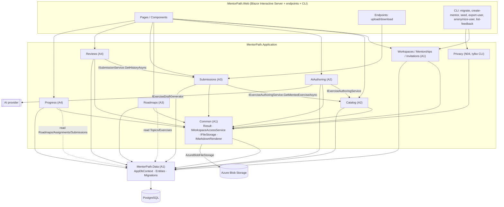

# MentorPath — Architektura solution

Status: **żywy dokument** (zweryfikowany z kodem 2026-10-19). Zmiany schematu i `Contracts/` — osobny PR z etykietą `schema-change` (D-41).

Źródło prawdy produktu: `docs/MVP_SPEC.md`. Reguły domenowe: `docs/DOMAIN_RULES.md` (kształty encji i DTO są w kodzie). Decyzje: `docs/DECISIONS.md`.

> Znaczniki A1–A5 w tym dokumencie są historyczne (model agentów z M0, zniesiony w D-41). Własność plików egzekwują CODEOWNERS i testy konwencji.

---

## 1. Zasady nadrzędne

1. **Modularny monolit, jeden proces, jedna baza PostgreSQL, jeden `AppDbContext`.**
2. Moduły to **foldery w jednym projekcie aplikacyjnym**, nie osobne projekty. Granice egzekwujemy własnością plików, kontraktami i testami, a nie liczbą projektów.
3. Brak: MediatR, generic repository, AutoMapper, CQRS framework, event bus, osobnego REST API dla ekranów Blazor, global query filters (D-22).
4. Serwis aplikacyjny = jedyne miejsce logiki biznesowej i autoryzacji zasobowej. Komponenty Razor **nie** używają `AppDbContext` ani `IDbContextFactory`.
5. Encje są kształtem danych (persistence model, własność A1). Reguły domenowe żyją w modułach (np. `Catalog/ExerciseValidator.cs`), co pozwala zamrozić schemat bez blokowania logiki.

---

## 2. Struktura solution

```
MentorPath/
├─ AGENTS.md
├─ MentorPath.slnx
├─ global.json                      # SDK 10.0.x
├─ Directory.Build.props            # Nullable, TreatWarningsAsErrors, LangVersion
├─ Directory.Packages.props         # Central Package Management (właściciel: A1)
├─ .editorconfig
├─ docker-compose.yml               # postgres, Azurite (Azure Blob), mailpit; profil `app`: migrate + app
├─ Dockerfile                       # A5 (B17)
├─ .github/workflows/ci.yml         # A1 tworzy (B01), A5 rozwija (B16/B17)
├─ docs/
├─ src/
│  ├─ MentorPath.Data/              # A1 — WYŁĄCZNIE A1
│  │  ├─ AppDbContext.cs
│  │  ├─ AppUser.cs
│  │  ├─ Entities/                  # wszystkie encje (kształt w kodzie, reguły w DOMAIN_RULES §3)
│  │  ├─ Enums/
│  │  ├─ Configurations/            # IEntityTypeConfiguration<T> per encja
│  │  └─ Migrations/
│  ├─ MentorPath.Application/
│  │  ├─ Common/                    # A1: Result, AppError, Access/, Storage/, Markdown/, Email/, Validation/
│  │  ├─ Workspaces/                # A1
│  │  ├─ Mentorships/               # A1
│  │  ├─ Invitations/               # A1
│  │  ├─ Catalog/                   # A2 (Topics + Exercises)
│  │  ├─ AiAuthoring/               # A2 (+ Providers/)
│  │  ├─ Roadmaps/                  # A3
│  │  ├─ Submissions/               # A3
│  │  ├─ Reviews/                   # A4 (Reviews + Reflections)
│  │  ├─ Progress/                  # A4
│  │  └─ Privacy/                   # N04: eksport i anonimizacja mentee (tylko CLI, D-42)
│  │     # Każdy moduł:
│  │     #   Contracts/            — interfejsy + DTO (ZAMROŻONE, zmiana przez CR)
│  │     #   <X>Service.cs         — implementacja (internal sealed)
│  │     #   <X>Module.cs          — public static IServiceCollection Add<X>Module(...)
│  └─ MentorPath.Web/
│     ├─ Program.cs                 # A1
│     ├─ Composition/               # A1: auth, cookies, rate limiting, health, headers, AddMentorPathModules()
│     ├─ Cli/                       # A1: migrate, create-mentor; A5: seed-demo (DemoSeed.cs); N04: export-user, anonymize-user (PrivacyCommands.cs); N03: list-feedback (FeedbackCommands.cs)
│     ├─ Endpoints/                 # A1: Account (jeśli potrzebne); A3: AttachmentEndpoints.cs, PracticalSubmissionEndpoints.cs
│     └─ Components/
│        ├─ App.razor, Routes.razor, _Imports.razor     # A1
│        ├─ Layout/ (MainLayout, MentorNav, MenteeNav)  # A1 — nawigacja dla WSZYSTKICH tras z MVP_SPEC §7
│        ├─ Shared/ (Markdown, StatusBadge, ConfidenceInput, LoadingState, EmptyState, ErrorState, ResultErrors)  # A1
│        ├─ Account/                # A1 (Identity: login, logout, reset hasła)
│        ├─ Pages/Invitations/      # A1 (/invite/{token})
│        ├─ Pages/Mentor/Mentees/   # A1 (/mentor/mentees, /mentor/mentees/{mentorshipId})
│        ├─ Pages/Mentor/Catalog/   # A2 (/mentor/catalog/topics, /mentor/catalog/topics/{id})
│        ├─ Pages/Mentor/Exercises/ # A2 (/mentor/exercises/new, /mentor/exercises/{id}/edit)
│        ├─ Pages/Mentor/Roadmaps/  # A3 (/mentor/mentees/{mentorshipId}/roadmap)
│        ├─ Pages/Mentor/Reviews/   # A4 (/mentor/reviews, /mentor/reviews/{submissionId})
│        ├─ Pages/Mentor/Dashboard/ # A4 (/mentor)
│        ├─ Pages/Mentee/Mentorships/ # A1 (/app/mentorships, /app/profile, onboarding)
│        ├─ Pages/Mentee/Home/      # A3 (/app)
│        ├─ Pages/Mentee/Roadmap/   # A3 (/app/roadmap/{mentorshipId})
│        ├─ Pages/Mentee/Assignments/ # A3 (/app/assignments/{id}, /history) — formularz refleksji = komponent A4
│        ├─ Pages/Mentee/Progress/  # A4 (/app/progress/{mentorshipId})
│        └─ Modules/
│           ├─ Progress/RoadmapProgressSummary.razor   # A4
│           ├─ Reviews/ReflectionForm.razor            # A4
│           └─ Submissions/SubmissionHistoryView.razor # A3 (używany też w review A4)
└─ tests/
   ├─ MentorPath.UnitTests/         # foldery per moduł, właściciel = właściciel modułu
   └─ MentorPath.IntegrationTests/
      ├─ Infrastructure/            # A1: PostgresFixture, TestDataBuilder (partial), AppFactory (WebApplicationFactory)
      ├─ <Module>/                  # właściciel modułu
      ├─ Isolation/                 # A5
      ├─ Release/                   # A5 — scenariusz release
      └─ Http/                      # A5 — WebApplicationFactory: login, antiforgery, upload/download, nagłówki
   └─ e2e/                          # A5 — Playwright smoke całego przepływu (D-33, D-55)
```

Uzasadnienie 3 projektów `src`:
- `Data` oddzielony, bo jest jedynym plikiem współdzielonym przez wszystkich i ma jednego właściciela (A1) — kompilator pilnuje, że `Data` nie zależy od modułów.
- `Application` oddzielony od `Web`, aby testy integracyjne wywoływały serwisy bez hosta Blazor.
- Adaptery (Azure Blob, AI over HTTP, SMTP) mieszkają w `Application` za interfejsami — osobny projekt `Infrastructure` nie daje w MVP wartości.

---

## 3. Kierunki zależności



Reguły:
- **Zapis** do tabeli tylko przez moduł-właściciela tej tabeli (macierz w `DOMAIN_RULES.md` §5, egzekwowana przez `ConventionTests`).
- **Odczyt** cudzych tabel bezpośrednio przez `AppDbContext` jest dozwolony (projekcje `Select` do własnych DTO), ale **zawsze po** sprawdzeniu dostępu i z filtrem `WorkspaceId`.
- Moduły wywołują się nawzajem tylko przez interfejsy z `Contracts/`. Brak cykli: `Catalog` nie zna `Roadmaps`; `Submissions` nie zna `Reviews`; `Progress` nie wywołuje serwisów innych modułów (tylko odczyt danych).
- `Web` nie referuje `Data` w kodzie komponentów (sprawdza test architektury A5: brak `AppDbContext`/`IDbContextFactory` w `Components/**`).

---

## 4. Dostęp do EF Core

- `services.AddDbContextFactory<AppDbContext>(...)` (Npgsql). Identity korzysta ze scoped `AppDbContext`; serwisy aplikacyjne **zawsze** `await using var db = await _factory.CreateDbContextAsync(ct);` per metoda.
- Brak długowiecznego `DbContext` w circuit Blazor. Brak zwracania encji do UI — tylko DTO (`record`).
- Odczyty: `AsNoTracking()` + `Select` do DTO. Zapisy: krótka transakcja w obrębie jednej metody.
- Brak global query filters. Każde zapytanie po danych workspace'u ma jawne `Where(x => x.WorkspaceId == workspaceId)`, gdzie `workspaceId` pochodzi z wyniku sprawdzenia dostępu (nigdy z requestu).
- Enumy zapisywane jako string (`HasConversion<string>()`), daty `DateTime` w UTC (`timestamptz`), czas z `TimeProvider`.
- Współbieżność: unikalne indeksy + warunkowe `ExecuteUpdateAsync` (patrz `DOMAIN_RULES.md` §8). Bez optymistycznych wersji wierszy w MVP.

---

## 5. Autoryzacja zasobowa

Dwa poziomy:
1. **Gruba bramka (UI):** `[Authorize(Roles = "Mentor")]` dla `/mentor/**`, `[Authorize(Roles = "Mentee")]` dla `/app/**`. To tylko nawigacja — **nie** jest dowodem uprawnień.
2. **Właściwa autoryzacja (serwis):** każda publiczna metoda serwisu przyjmuje `Guid actorUserId` i przed odczytem/zapisem woła `IWorkspaceAccessService`.

Propagacja `WorkspaceId` (D-08):
- **Mentor:** `WorkspaceId` wyliczany z `actorUserId` (`Workspace.OwnerUserId` jest unikalny). UI nigdy nie przekazuje `WorkspaceId`.
- **Mentee:** `WorkspaceId` wyliczany z zasobu (assignment → roadmap item → roadmap → mentorship) i weryfikowany: `Mentorship.MenteeUserId == actorUserId`.
- **Insert:** `WorkspaceId` dziecka kopiowany z zweryfikowanego rodzica. Złożone FK `(WorkspaceId, ParentId)` w bazie uniemożliwiają niespójność.
- "Aktywny mentoring" mentee (IAM-05) to stan nawigacji UI, **nie** wejście autoryzacji.
- Brak dostępu i brak zasobu → ten sam wynik `NotFound` (brak enumeracji ID).

`actorUserId` pobiera warstwa Web z `AuthenticationState` (claim `NameIdentifier`) — helper `CurrentUser` w `Components/Shared` (A1).

---

## 6. Upload i download (B12)

- Upload praktycznego zadania: **dedykowany endpoint** `POST /api/assignments/{assignmentId}/practical-submissions` (multipart, cookie auth, antiforgery, `RequestSizeLimit` 11 MB, rate limit per user). Formularz Blazor wysyła go przez `fetch` z tokenem antiforgery. Endpoint woła `ISubmissionService.SubmitPracticalAsync` — ta sama logika co dla linku.
- Walidacja: ≤ 10 MB, rozszerzenie ∈ {pdf, txt, md, png, jpg, jpeg}, Content-Type z allowlisty, **sygnatura** (PDF `%PDF`, PNG `89 50 4E 47`, JPG `FF D8 FF`; TXT/MD: poprawny UTF-8, brak bajtów NUL).
- `ObjectKey = "ws/{workspaceId:N}/sub/{Guid.NewGuid():N}"` — bez nazwy pliku i danych osobowych.
- Kolejność: zapis do storage → transakcja DB; jeśli DB się nie powiedzie → `DeleteAsync` (best-effort, log). Sieroty po awarii = znane ryzyko MVP.
- Download: `GET /api/attachments/{attachmentId}` → `ISubmissionService.OpenAttachmentAsync` (autoryzacja) → `Results.File(..., fileDownloadName)` z `Content-Disposition: attachment`, `X-Content-Type-Options: nosniff`, `Cache-Control: private, no-store`.
- Kontener Blob prywatny, brak publicznych URL i SAS w MVP. Dostęp aplikacji przez managed identity (D-47).
- Linki zewnętrzne: tylko `http`/`https`, ≤ 2000 znaków, nigdy nie pobierane przez serwer; renderowane z `rel="noopener noreferrer nofollow"`.

---

## 7. AI przez adapter (B07)

```
IAiExerciseDraftService (A2, kontrakt publiczny)
   ├─ buduje prompt (PromptTemplateVersion, tylko dane tematu + wejście mentora)
   ├─ sprawdza limit workspace'u
   ├─ IExerciseDraftGenerator (port dostawcy)
   │     ├─ FakeExerciseDraftGenerator   — deterministyczny; tryby: ok / invalid-json / timeout / error
   │     └─ OpenAiCompatibleDraftGenerator — HttpClient + JSON schema (structured output), bez SDK dostawcy
   ├─ AiDraftValidator — schemat JSON + reguły domenowe + brak HTML
   └─ IExerciseAuthoringService.CreateDraftAsync(... Source = AI)  → zawsze Draft
```
- Wywołanie synchroniczne w circuit z timeoutem (`Ai:TimeoutSeconds`, domyślnie 60 s); brak kolejek i workerów.
- Do providera **nie trafiają**: dane mentee, `MentorPrivateNotes`, rozwiązania, e-maile. Do logów nie trafiają prompty ani odpowiedzi — tylko status, provider, model, tokeny, `ErrorCode`.
- `Ai:Provider = Fake` w Development, testach i CI.

---

## 8. Konfiguracja i sekrety

Tylko zmienne środowiskowe / user-secrets. `appsettings.json` bez sekretów.

| Klucz | Opis |
|---|---|
| `ConnectionStrings__Default` | PostgreSQL |
| `App__PublicBaseUrl` | baza linków zaproszeń / resetu hasła |
| `Storage__Provider` | `AzureBlob` (domyślnie), `InMemory` wyłącznie jawnie w testach; zabronione w Production |
| `Storage__AzureBlob__ServiceUri`, `__ContainerName` | Endpoint HTTPS konta i prywatny kontener; `DefaultAzureCredential` (managed identity / `az login`) |
| `Storage__AzureBlob__ConnectionString` | Lokalnie Azurite; ma pierwszeństwo przed `ServiceUri` |
| `DataProtection__BlobUri` | Prywatny blob kluczy Identity, wspólny dla web i CLI; ma pierwszeństwo przed `KeysPath` |
| `Ai__Provider` (`Fake`/`OpenAiCompatible`), `Ai__BaseUrl`, `Ai__Model`, `Ai__ApiKey`, `Ai__TimeoutSeconds`, `Ai__MaxOutputTokens`, `Ai__MonthlyGenerationLimitPerWorkspace` | AI |
| `Email__Smtp__Host`, `__Port`, `__User`, `__Password`, `__From` | e-mail transakcyjny (reset hasła, D-11) |

Lokalnie: `docker compose up -d` (postgres, Azurite, mailpit) + `dotnet run --project src/MentorPath.Web` (D-47 zastępuje D-31). Instrukcja Azure: `AZURE_DEPLOYMENT.md`.

---

## 9. CLI w tym samym binarium

`dotnet MentorPath.Web.dll <verb>` — ten sam DI i konfiguracja, jeden obraz Docker:
- `migrate` — stosuje migracje (deploy: krok przed startem aplikacji). W Development migracje także przy starcie.
- `create-mentor --email --name --workspace` — tworzy użytkownika (rola Mentor) + Workspace, wypisuje jednorazowy link ustawienia hasła (D-11).
- `seed-demo` — tylko `Development` (lub `--force`): 2 mentorów, 2 mentees (jedna w obu workspace'ach), katalog, roadmapy (D-34).
- `export-user (--email | --user-id) --out <plik>` — eksport danych osobowych mentee do pliku JSON (D-42).
- `anonymize-user (--email | --user-id) [--confirm]` — anonimizacja mentee; bez `--confirm` tylko podgląd (D-42). Procedura: `docs/DATA_RETENTION.md`.
- `list-feedback [--limit <1-500>]` — uwagi do produktu od najnowszych, z identyfikatorem autora (N03, D-56). Drukuje treść uwag, więc uruchamiaj w terminalu, nie w potoku logów.

---

## 10. Bezpieczeństwo przekrojowe (A1 konfiguruje, A5 weryfikuje)

- Cookies: `HttpOnly`, `Secure`, `SameSite=Lax`, sliding 8 h; lockout 5 prób / 15 min; hasło ≥ 10 znaków.
- Antiforgery: domyślne dla formularzy SSR + endpointów uploadu.
- Rate limiting (`Microsoft.AspNetCore.RateLimiting`): login, reset hasła, `/invite/*`, upload. AI ograniczane limitem workspace'u.
- Markdown: `Markdig` z `DisableHtml()` + `HtmlSanitizer` na wyjściu; jedyny sposób renderowania to komponent `<Markdown>` (A1). Zakaz `MarkupString` z danych użytkownika poza tym komponentem.
- Nagłówki: `X-Content-Type-Options`, `Referrer-Policy: strict-origin-when-cross-origin`, `Content-Security-Policy: frame-ancestors 'none'` (A5 może zaostrzyć).
- HTTPS + HSTS poza Development. Logi strukturalne (JSON console), bez e-maili, tokenów, treści rozwiązań.
- Health: `/health/live`, `/health/ready` (DB).

---

## 11. Strategia testów

| Poziom | Projekt | Co | Narzędzia |
|---|---|---|---|
| Unit | `UnitTests` | walidatory (quiz, AI JSON, upload signature), `ProgressCalculator`, hash tokenu, reguły statusów | xUnit, Shouldly (bez FluentAssertions ≥ 8 — licencja) |
| Integracyjne | `IntegrationTests` | każdy serwis na prawdziwym PostgreSQL; migracje od zera | Testcontainers.PostgreSql |
| Izolacja | `IntegrationTests/Isolation` | macierz: każda metoda serwisu z ID zasobu × {Mentor B, obca mentee} → `NotFound` | j.w. |
| HTTP | `IntegrationTests` | upload/download, antiforgery, cookie auth | `WebApplicationFactory` |
| Release | `IntegrationTests/Release` | 12 kroków z `DOMAIN_RULES.md` §9 jako jeden test na serwisach + endpointach | j.w. |

Zasady:
- Jeden kontener PostgreSQL na assembly (collection fixture), migracje raz. **Każdy test tworzy własne workspace'y** przez `TestDataBuilder` → brak czyszczenia, testy równoległe, brak wycieku fixture'ów.
- `TestDataBuilder` (A1) tworzy dane przez serwisy aplikacji (D-32); rozszerzenia w plikach partial per agent.
- `IFileStorage` w testach serwisów = jawnie `InMemoryFileStorage`; adapter Azure Blob ma testy integracyjne na Azurite (upload/download, Content-Type, prywatność, usuwanie, anulowanie).
- `TimeProvider` → `FakeTimeProvider` dla wygasania zaproszeń.
- E2E przeglądarkowe: `tests/e2e/ui-smoke.js` (Playwright) — wymagany job CI dla pull requestów i pushy do `main`; można też uruchomić lokalnie (D-55).

---

## 12. Strategia migracji

- Jedna migracja inicjalna `InitialSchema` obejmuje **cały** model MVP (D-09).
- Kolejne zmiany: osobny PR z etykietą `schema-change` (migracja + encje + konfiguracja), review CODEOWNERS, merge przed PR funkcjonalnym. Nigdy nie edytujemy zmergowanej migracji (skill `add-migration`).
- CI (krok „EF model matches migrations”): `dotnet ef migrations has-pending-model-changes` musi zwrócić brak zmian; test integracyjny stosuje migracje na pustej bazie.
- Produkcja: `migrate` jako osobny krok deploymentu; backup bazy przed migracją (B17).
