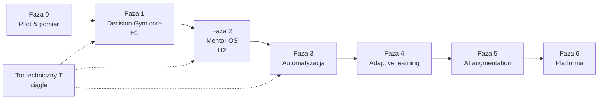

# MentorPath — Backlog rozwoju po MVP (v2)

Status: **ADOPTED (2026-10-18)** — decyzje D-36…D-40 zaakceptowane. Zmiany zakresu faz: decyzja w `DECISIONS.md` (D-41).
Źródła (historyczne): `docs/archive/deep-research-report.md` (research z 17.10.2026), `docs/archive/IMPLEMENTATION_PLAN.md` §0, `docs/archive/BACKLOG-v1.md` (P1).
Sposób pracy: `AGENTS.md` i `docs/WORKFLOW.md` (D-41). Każda pozycja N-xx staje się issue z szablonu `backlog-item`; zmiana schematu = osobny PR z etykietą `schema-change`. Kolumna „Agent” poniżej jest historyczna. **Status prac śledzimy na tablicy** [MentorPath Backlog](https://github.com/users/szkoladotneta/projects/6) (issue #1–#42 odpowiadają pozycjom N01–T06); ten plik jest planem produktowym.

---

## 1. Teza produktowa (z researchu)

> **Personal Architecture Gym dla .NET** — miejsce, w którym developer regularnie *ćwiczy podejmowanie decyzji architektonicznych*, dostaje ustrukturyzowany feedback od mentora i buduje **dowody**, że potrafi samodzielnie projektować backend.

Wartością nie są konta, quizy, roadmapy ani upload (to commodity — Moodle robi to wszystko), lecz:
**model uczenia decyzji + biblioteka scenariuszy + rubryka procesu decyzyjnego + historia rozwoju sposobu myślenia mentee.**

Dwie hipotezy, które backlog ma weryfikować w tej kolejności:

| # | Hipoteza | Jak mierzymy |
|---|---|---|
| **H1** | Pętla *wyzwanie → decyzja → ustrukturyzowane review → poprawka* zauważalnie poprawia jakość decyzji mentee | Trend ocen rubryki per kryterium, `reviewed → resubmitted`, `same mistake recurrence` |
| **H2** | System pozwala mentorowi prowadzić więcej osób bez proporcjonalnego wzrostu czasu | **Minuty pracy mentora na jedną nową kompetencję „Demonstrated”**, `reused exercises / assignments`, czas review |

Rozwój dzielimy według **ryzyk, które usuwamy**, a nie liczby funkcji. Faza N+1 startuje dopiero po spełnieniu warunku wyjścia z fazy N (z wyjątkiem toru technicznego T).

---

## 2. Gap analysis: research vs. obecne MVP

| Rekomendacja researchu | Stan MVP | Luka → pozycja backlogu |
|---|---|---|
| Pilotaż na realnej mentee, notowanie „brakuje mi X” | Aplikacja gotowa lokalnie, brak wdrożenia i pomiaru | N01–N04 |
| Metryki pętli mentoringowej (nie DAU) | Dane częściowo w tabelach, brak widoku i zdarzeń „started/opened” | N02 |
| Rubryka **procesu decyzyjnego** (6 kryteriów, skala) | `RubricMarkdown` (tekst) + werdykt Accepted/NeedsRevision | N10 |
| Wynik review: Retry / Follow-up / Mastered / Needs prerequisite | Tylko Accepted / NeedsRevision | N11 |
| Status kompetencji: Not assessed → Learning → Practicing → Demonstrated → Needs revisit | Postęp = % ukończonych tematów (wyliczany) | N12 |
| „Next action jest produktem” | Dashboard mentee z listą następnych zadań | N13 |
| Odpowiedź: zrozumienie problemu + **brakujące informacje** + opcje + wybór + koszty + trigger zmiany | 6 pól (bez „zrozumienia” i „brakujących informacji”) | N14 |
| Inbox mentora z „resubmitted”, poprzednią próbą, kompetencjami | Kolejka FIFO + historia prób | N15 |
| Kalibracja pewności (confidence vs ocena mentora) | Confidence 1–5 zapisywane, nie analizowane | N16 |
| Widoczny dowód zmiany sposobu myślenia w czasie | Brak | N17 |
| Powtarzające się błędy | Brak | N19 |
| **Graf kompetencji z prerequisites**, katalog niezależny od wersji .NET | Płaski katalog tematów | N20 |
| Exercise = reusable content, wiele kompetencji, biblioteka | Exercise 1:1 z tematem, lista w temacie | N22, N26 |
| Szablony roadmap (Learning Plan z katalogu) | Roadmapa budowana ręcznie od zera | N21 |
| Widok tematu: why it matters / you should be able to / zasoby | Opis + cele tematu + rationale | N23 |
| Typy ćwiczeń: architecture review, code review, failure, incident, prediction, teach-back… — bez nowych rendererów | 3 typy | N24 |
| Push → CI → wynik w platformie (bez GitHub Classroom — wycofany 28.08.2026) | Link do repo jako zwykły URL | N32, N33 |
| Przypomnienia, reguły progresji | Brak | N30, N31, N34 |
| Diagnoza, spaced revisits, sugestie „next” | Brak | N40–N42 |
| AI podpowiada mentorowi „gdzie nacisnąć” (późno, na danych) | AI generuje szkice ćwiczeń | N50–N53 |

**Co już jest zgodne z researchem i zostaje:** modularny monolit .NET 10 LTS, relacyjna baza (graf w tabeli, bez graph DB), pliki w object storage, content jako dane, praca poza platformą (własne IDE + URL/plik), Exercise vs Assignment, ADR-owa forma odpowiedzi, confidence, AI tylko jako szkic zatwierdzany przez mentora.

---

## 3. Zasady produktowe (guardrails dla wszystkich faz)

1. **Next action > dashboard.** Każdy ekran mentee odpowiada na „co mam zrobić teraz?”.
2. **Maszyna sprawdza correctness, mentor sprawdza judgement.** Automaty (CI, quizy) nigdy nie nadają statusu „Demonstrated”.
3. **Mentor jest algorytmem personalizacji**, system tylko sugeruje (do czasu, aż sugestie regularnie pokrywają się z decyzjami mentora).
4. **Content jako dane.** Żadnej logiki zależnej od konkretnego tematu w kodzie; kompetencje niezależne od wersji .NET, wersja technologii to atrybut ćwiczenia.
5. **Nie budujemy Udemy dla jednej osoby.** Zakazane bez nowego dowodu z pilotażu: kursy/lekcje/wideo, certyfikaty, gamifikacja (streaki, odznaki, rankingi), chat realtime, wideo, kalendarz, własne IDE/runner C#, mikroserwisy, event bus, rekomendacje ML, aplikacja mobilna, graph DB.
6. **Mierzymy pętlę, nie zaangażowanie** (§6). Każda funkcja ma wskazaną metrykę, którą ma poprawić.

---

## 4. Fazy i warunki przejścia

| Faza | Pytanie | Warunek wyjścia (mierzalny) | Szacunek |
|---|---|---|---|
| **0 Pilot & pomiar** | Czy realna mentee pracuje w aplikacji jako głównym miejscu mentoringu? | ≥ 4 tygodnie pilotażu; ≥ 8 ocenionych prób; ≥ 60% `NeedsRevision` kończy się nową próbą w ≤ 7 dni; friction log ≥ 15 wpisów | ~36 h |
| **1 Decision Gym core** | Czy ustrukturyzowane review procesu decyzyjnego daje widoczny rozwój (H1)? | Rubryka użyta w ≥ 80% review; ≥ 2 kryteria z trendem wzrostowym u mentee pilotażowej po 6 tyg.; mentor ocenia, że feedback jest szybszy/lepszy niż przed rubryką | ~100 h |
| **2 Mentor OS** | Czy kolejna osoba wymaga istotnie mniej pracy organizacyjnej (H2)? | 2.–3. mentee: ≥ 60% przypisań z biblioteki; przygotowanie ścieżki nowej osoby < 60 min; spadek „minut / Demonstrated” | ~85 h |
| **3 Automatyzacja** | Co można zautomatyzować bez utraty jakości feedbacku? | ≥ 50% zadań praktycznych z wynikiem CI; czas `submitted → reviewed` nie rośnie przy większej liczbie mentees | ~70 h |
| **4 Adaptive learning** | Czy system potrafi trafnie sugerować następny krok? | Sugestie „next” akceptowane przez mentora w ≥ 60% przypadków | ~55 h |
| **5 AI augmentation** | Gdzie AI oszczędza czas mentora, nie psując mentoringu? | Start po ≥ 300 review z rubryką; mentor zmienia ≤ 30% treści sugestii; czas review spada | ~60 h |
| **6 Platforma** | Czy istnieje produkt niezależny od jednego mentora? | Inni mentorzy osiągają wyniki bez ręcznej obsługi — **poza zakresem planowania** | — |

---

## 5. Backlog

Priorytet w fazie: **M** = Must (warunek wyjścia), **S** = Should, **C** = Could. Szacunki w godzinach pracy agenta (konwencja z `archive/BACKLOG-v1.md`). „Schemat” = wymaga osobnego PR `schema-change`.

### Faza 0 — Pilot i pomiar

| ID | Pozycja | Pr. | Agent | Schemat | h |
|---|---|---|---|---|---|
| N01 | Wdrożenie pilotażowe: zdalne repo GitHub + CI, Azure (kontener App Service, zarządzany PostgreSQL z PITR, prywatny Blob Storage), SMTP, domena + HTTPS, backup z testem odtworzenia | M | A5 | — | 10 |
| N02 | Pomiar pętli: tabela `ActivityEvents` (append-only: `assignment_opened`, `review_opened`, `review_submitted` z czasem trwania) + strona `/mentor/insights` z metrykami z §6 | M | A4 (+A1 CR) | tak | 14 |
| N03 | Friction log: przycisk „Uwaga do produktu” (mentor i mentee) → tabela `ProductFeedback`, lista dla operatora | S | A1 | tak | 4 |
| N04 | RODO minimum: CLI `export-user` (JSON wszystkich danych osoby) i `anonymize-user`; polityka retencji w `docs/` | M | A1 | — | 8 |

Kryteria akceptacji (wybrane):
- **N02:** metryki liczone wyłącznie z danych własnego workspace'u (test izolacji); zdarzenia nie zawierają treści odpowiedzi; czas review mierzony od otwarcia do wysłania feedbacku (z odcięciem > 2 h bezczynności).
- **N04:** eksport obejmuje profil, relacje, próby, załączniki (klucze), feedback, refleksje; anonimizacja zachowuje statystyki workspace'u, usuwa PII i pliki.

### Faza 1 — Decision Gym core (H1)

| ID | Pozycja | Pr. | Agent | Schemat | h |
|---|---|---|---|---|---|
| N10 | **Rubryka procesu decyzyjnego**: domyślny zestaw 6 kryteriów (Rozpoznanie ograniczeń, Alternatywy, Trade-offs, Ewolucja rozwiązania, Operacyjność, Komunikacja) z opisami poziomów 1–5, edytowalny per workspace; ćwiczenie wybiera kryteria; review zapisuje ocenę + komentarz per kryterium; mentee widzi paski i opisy poziomów | M | A4 (+A2 edytor ćwiczeń) | tak | 18 |
| N11 | **Następny krok w review**: obok werdyktu wybór *Retry* / *Follow-up exercise* / *Demonstrated* / *Needs prerequisite*; follow-up i prerequisite tworzą przypisanie na roadmapie w tej samej akcji | M | A4 + A3 | tak | 12 |
| N12 | **Status kompetencji** per element roadmapy (Not assessed, Learning, Practicing, Demonstrated, Needs revisit) ustawiany przez mentora, z sugestią systemu i listą dowodów (próby); historia zmian; postęp = Demonstrated / aktywne | M | A3 + A4 | tak | 12 |
| N13 | **Next action** dla mentee: jedna karta „Co teraz?” (najpierw NeedsRevision, potem pierwsze wymagane niezaliczone wg kolejności), bieżący fokus z węzłami i statusami, ostatni feedback | M | A3 | — | 8 |
| N14 | **Odpowiedź decyzyjna v2** (`schemaVersion: 2`): + „Jak rozumiesz problem”, + „Czego nie wiesz / jakie przyjmujesz założenia”; v1 nadal czytelne w historii | M | A3 | — (JSON) | 8 |
| N15 | **Inbox mentora**: oznaczenie „ponowna próba #n”, czas oczekiwania (badge > 48 h), filtry (mentee, typ), poprzednia próba obok bieżącej, powiązane kompetencje | S | A4 | — | 8 |
| N16 | **Kalibracja pewności**: wykres/tabela confidence-before vs średnia rubryki/werdykt w czasie (mentor i mentee); skala pozostaje 1–5 | S | A4 | — | 6 |
| N17 | **Historia rozwoju**: oś czasu ocen per kryterium rubryki (sparklines), z odnośnikami do prób; widok w profilu mentee i dla mentee | S | A4 | — | 10 |
| N18 | Odpowiedź mentee na pytanie pogłębiające (pole w refleksji, widoczne w review kolejnej próby) | S | A4 | tak | 4 |
| N19 | **Tagi błędów** w review (np. „pomija failure modes”, „pattern dumping”), słownik per workspace; metryka powtarzalności błędu | C | A4 | tak | 8 |

Kryteria akceptacji (wybrane):
- **N10:** review bez ocen wszystkich wybranych kryteriów jest blokowany; oceny niezmienne po wysłaniu (jak feedback); DTO mentee pokazuje oceny, nie pokazuje prywatnych notatek mentora; migracja zachowuje istniejące `RubricMarkdown` jako opis zadania.
- **N11:** cała akcja w jednej transakcji z ochroną współbieżności (jak inv. 10); prerequisite tylko z kompetencji tego samego workspace'u; mentee widzi nowe zadanie od razu.
- **N12:** status nadawany wyłącznie przez mentora; „Demonstrated” wymaga ≥ 1 próby Accepted lub ręcznego uzasadnienia; zmiana statusu zapisuje autora i czas.
- **N13:** dla mentee z wieloma mentoringami karta per aktywny mentoring; brak opublikowanej roadmapy → komunikat, nie błąd.

### Faza 2 — Mentor OS (H2)

| ID | Pozycja | Pr. | Agent | Schemat | h |
|---|---|---|---|---|---|
| N20 | **Kompetencje jako graf**: `Topic` ewoluuje w `Competency` (D-37) + tabela `CompetencyPrerequisites` (walidacja cykli); na roadmapie węzły z niespełnionymi prerequisites oznaczone 🔒 (doradczo, nie blokująco) | M | A2 + A3 | tak | 16 |
| N21 | **Szablony ścieżek**: zapis roadmapy jako szablon; nowa roadmapa z szablonu, potem ręczna edycja (wyłącz/zmień kolejność) | M | A3 | tak | 12 |
| N22 | **Biblioteka ćwiczeń**: wyszukiwarka i filtry (kompetencja, typ, format, trudność), statystyki użycia (w ilu roadmapach, średnia liczba prób, średnia rubryki) | M | A2 | — | 8 |
| N23 | **Strona kompetencji dla mentee**: kontekst tematu (opis, opcjonalne `WhyItMattersMarkdown`, cele edukacyjne), zasoby artykułów/wideo, notatka mentora i przypisane ćwiczenia ze statusem na stronie `/app/roadmap/{mentorshipId}/topics/{roadmapItemId}` z mapy i listy; osadzanie YouTube/Vimeo dopiero po kliknięciu; przygotowanie nie blokuje ćwiczeń (D-52, D-53) | S | A2 + A3 | tak | 10 |
| N24 | **Formaty ćwiczeń bez nowych rendererów**: atrybut `Format` (Decision scenario, Architecture review, Code review, Failure scenario, Incident analysis, Prediction, Teach-back, Adversarial question) z szablonem treści i domyślnymi kryteriami rubryki; załączniki do treści ćwiczenia (np. diagram PNG) | S | A2 | tak | 12 |
| N25 | Wieloma kompetencjami na ćwiczenie (`ExerciseCompetencies` z wagą), główny temat pozostaje | S | A2 | tak | 6 |
| N26 | Rodowód wersji ćwiczeń (`SourceExerciseId`, numer wersji) — statystyki biblioteki łączą wersje | C | A2 | tak | 4 |
| N27 | Startowy katalog kompetencji .NET (13 obszarów decyzji z researchu) jako import/seed szablonu workspace'u | S | A2 + mentor (content) | — | 8 + content |
| N28 | **Wizualna mapa roadmapy** (mentee: „gdzie jestem / co zostało”; mentor: podgląd ścieżki mentee) — SVG po stronie serwera, bez nowych pakietów (D-44) | M | A3 | nie | 12 |
| N29 | **Poddrzewa tematów**: `Topic.ParentTopicId` (drzewo, głębokość ≤ 3), edycja w katalogu, gałęzie na mapie z N28 (D-45); poprzedza N20 | M | A2 + A3 | tak | 16 |

Kryteria akceptacji (wybrane):
- **N28:** mentee widzi mapę tylko własnej, opublikowanej roadmapy; mentor tylko własnego workspace'u; obcy mentor/mentee i nieznany użytkownik → `NotFound`; stany węzłów zgodne z D-16; widok czytelny z klawiatury (aria), stany ładowania/pusty/błąd.
- **N29:** rodzic tylko z tego samego workspace'u (złożony FK, inny workspace → `NotFound`); cykl lub głębokość > 3 → walidacja; podtemat poza planem mentee widoczny wyłącznie jako szary tytuł; zmiana nie wpływa na liczenie postępu.
- **N20:** prerequisite tylko w obrębie workspace'u (złożony FK); próba utworzenia cyklu → błąd walidacji; migracja zachowuje ID tematów i wszystkie powiązania.
- **N21:** szablon nie zawiera danych mentee; klonowanie tylko z własnego workspace'u; zmiana szablonu nie zmienia istniejących roadmap.

### Faza 3 — Automatyzacja

| ID | Pozycja | Pr. | Agent | Schemat | h |
|---|---|---|---|---|---|
| N30 | **Powiadomienia e-mail**: nowe rozwiązanie → mentor, feedback → mentee, opcjonalny dzienny digest; opt-out per użytkownik | M | A4 (+A1 e-mail) | tak | 10 |
| N31 | **Przypomnienia**: zbliżający się termin, `NeedsRevision` bez reakcji > 7 dni, review czekające > 48 h; zadania w tle w tym samym procesie (T05) | S | A4 | tak | 8 |
| N32 | **Wyniki CI w review**: przypięcie repo/PR do próby; GitHub App/webhook (`workflow_run`, `check_suite`) z weryfikacją podpisu; status buildu i testów w review; platforma nigdy nie uruchamia kodu mentee | M | A3 + A5 | tak | 24 |
| N33 | **Startowe repozytoria zadań**: `TemplateRepositoryUrl` przy ćwiczeniu praktycznym + gotowy workflow testów w szablonie (content) | S | A2 | tak | 4 + content |
| N34 | **Reguły progresji** (bez AI): np. dwa NeedsRevision z rzędu → sugeruj prerequisite; wszystkie wymagane Accepted → sugeruj Demonstrated; sugestie w inboxie do akceptacji przez mentora | S | A4 | tak | 10 |

### Faza 4 — Adaptive learning

| ID | Pozycja | Pr. | Agent | Schemat | h |
|---|---|---|---|---|---|
| N40 | **Diagnoza wejściowa**: zestaw diagnostyczny (krótkie quizy i scenariusz per obszar) przy onboardingu; mentor ustawia statusy startowe na podstawie wyników | M | A3 + A4 | tak | 12 |
| N41 | **Powtórki rozłożone w czasie**: kompetencja Demonstrated → quiz powtórkowy po 2/6/12 tygodniach; porażka sugeruje „Needs revisit” | M | A4 | tak | 12 |
| N42 | **Silnik sugestii „następne zadanie”** (reguły + dane historyczne) z metryką trafności (akceptacja/zmiana przez mentora) | M | A4 | tak | 14 |
| N43 | Quiz z krótką odpowiedzią tekstową (ocena mentora lub dopasowanie wzorca) | C | A2 + A3 | tak | 10 |

### Faza 5 — AI augmentation (start po ≥ 300 review z rubryką)

| ID | Pozycja | Pr. | Agent | Schemat | h |
|---|---|---|---|---|---|
| N50 | **AI szkic review dla mentora**: propozycja ocen rubryki, mocnych stron i pytań sokratejskich; zawsze edytowalny, nigdy wysyłany automatycznie. Wymaga zmiany AI-05 i zgody mentee (D-40) | M | A4 + A2 | tak | 20 |
| N51 | **Podpowiedzi „gdzie nacisnąć”** na podstawie historii mentee (powtarzające się błędy, kalibracja) | S | A4 | — | 12 |
| N52 | Generowanie wariantów scenariuszy dla kompetencji z biblioteki (kontekst: rubryka, istniejące ćwiczenia) | S | A2 | — | 8 |
| N53 | Sugestie planu dla nowej osoby (z diagnozy + szablonów), akceptowane przez mentora | C | A3 | — | 12 |
| N54 | Metryki AI: % sugestii zmienionych przez mentora, czas review z AI i bez AI | M | A4 | — | 6 |

### Tor techniczny T (równolegle, wg potrzeb faz)

| ID | Pozycja | Kiedy | Agent | h |
|---|---|---|---|---|
| T01 | Smoke Playwright w CI (kontenery + `seed-demo`) | Faza 0 | A5 | 6 |
| T02 | Zaostrzenie CSP (`script-src 'self'`), szyfrowanie kluczy Data Protection | Faza 0 | A1/A5 | 4 |
| T03 | Sprzątanie osieroconych blobów (job porównujący kontener Azure Blob z `SubmissionAttachments`) | Faza 3 | A3 | 4 |
| T04 | Wersjonowane DTO i migracje danych JSON (DecisionAnswer v1→v2) — wzorzec dla kolejnych zmian | Faza 1 | A1 | 4 |
| T05 | Infrastruktura zadań w tle (`BackgroundService` + `PeriodicTimer`, blokada w bazie przed podwójnym uruchomieniem); bez kolejek i event busa | Faza 3 | A1 | 6 |
| T06 | Gotowość do > 1 instancji (sticky sessions, klucze Data Protection w bazie) — dopiero przy realnej potrzebie | Faza 6 | A1/A5 | 6 |

---

## 6. Metryki (definicje i źródła danych)

| Metryka | Definicja | Źródło | Faza |
|---|---|---|---|
| `exercise_started → submitted` | % otwartych przypisań z co najmniej jedną próbą w 14 dni | `ActivityEvents` + `Submissions` | 0 |
| `submitted → reviewed` | mediana godzin od `SubmittedAtUtc` do `MentorFeedback.CreatedAtUtc` | istniejące tabele | 0 |
| `reviewed → resubmitted` | % NeedsRevision z kolejną próbą w ≤ 7 dni | istniejące tabele | 0 |
| Czas review mentora | mediana minut `review_opened → review_submitted` | `ActivityEvents` | 0 |
| Próby na Demonstrated | średnia liczba prób na kompetencję w statusie Demonstrated | N12 | 1 |
| Trend rubryki | nachylenie średniej oceny per kryterium w 6 tyg. | N10 | 1 |
| Kalibracja | korelacja confidence-before ↔ średnia rubryki | N10, N16 | 1 |
| Powtarzalność błędu | % tagów błędów, które wracają w kolejnych 3 próbach | N19 | 1 |
| Reuse biblioteki | przypisania z ćwiczeń użytych wcześniej / wszystkie przypisania | `Assignments` | 2 |
| **Minuty mentora / Demonstrated** | suma czasu review i przygotowania ścieżki ÷ nowe Demonstrated w okresie | N02 + N12 | 2+ |
| Trafność sugestii | % sugestii zaakceptowanych bez zmian | N34, N42 | 3–4 |
| Edycja AI | % treści sugestii AI zmienionej przez mentora | N54 | 5 |

---

## 7. Proponowany pierwszy sprint (≈ 2 tygodnie, ~60 h)

1. **N01** wdrożenie pilotażowe + **T01/T02** — aplikacja dostępna dla realnej mentee.
2. **N04** RODO minimum — warunek pracy na prawdziwych danych.
3. **N02** pomiar pętli — dane od pierwszego dnia pilotażu.
4. **N13** Next action — największa zmiana UX przy zerowym koszcie schematu.
5. **N10** rubryka procesu decyzyjnego — rdzeń H1 (CR schematu jako pierwszy merge).

Pilotaż (Faza 0) trwa w trakcie budowy Fazy 1; priorytety N11–N19 korygujemy co tydzień na podstawie friction logu (N03).

---

## 8. Decyzje (zaakceptowane 2026-10-18)

Szczegóły w `docs/DECISIONS.md` (D-36…D-40).

1. **D-36** Pilot równolegle z Fazą 1 (nie Moodle/Notion — MVP już spełnia rolę narzędzia concierge).
2. **D-37** `Topic` ewoluuje w `Competency` (jedna encja, bez równoległego katalogu).
3. **D-38** Domyślna rubryka procesu decyzyjnego: 6 kryteriów, skala 1–5, edytowalna per workspace; `RubricMarkdown` zostaje jako kryteria specyficzne dla zadania.
4. **D-39** Status kompetencji ustawia mentor; system tylko sugeruje. Postęp roadmapy = Demonstrated / aktywne. Confidence pozostaje w skali 1–5.
5. **D-40** AI w review (Faza 5) wymaga zmiany AI-05 (wysyłanie rozwiązań mentee do dostawcy AI) i świadomej zgody mentee — decyzja przed startem Fazy 5.

## 9. Poza zakresem (świadomie)

Zgodnie z researchem i §3.5: AI-mentor i AI-generowana roadmapa (przed Fazą 5), chat realtime, wideo, kalendarz, płatności i marketplace (Faza 6), forum, gamifikacja, aplikacja mobilna, własne IDE i runner C#, GitHub Classroom (wycofany), mikroserwisy, event bus, graph DB, rekomendacje ML.
