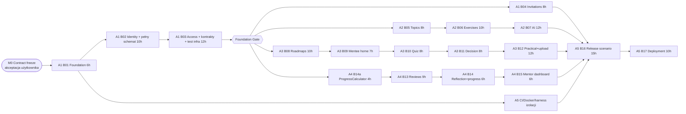

# MentorPath — Implementation Plan

Status: **ADOPTED (M0, 2026-10-17)** — zmiany tylko przez Change Request.

Zasada: najpierw krótka, sekwencyjna ścieżka A1 (M1), która zamraża schemat, kontrakty i infrastrukturę testów. Dzięki temu A2, A3 i A4 startują **jednocześnie** i seedują dane bez czekania na siebie nawzajem (D-09).

---

## 0. Status realizacji (2026-10-18)

Użytkownik delegował akceptację M0 i realizację MVP na Tech Leada. Brak narzędzi do uruchamiania osobnych sesji agentów — zadania B01–B17 zrealizowano sekwencyjnie w jednej sesji, z zachowaniem granic modułów i własności plików z `AGENTS.md`.

| Milestone | Zadania | Status | Dowód |
|---|---|---|---|
| M0 Contract freeze | — | ✅ | Dokumenty ADOPTED, decyzje D-08…D-35 |
| M1 Foundation | B01–B03 | ✅ | `InitialSchema`, `IWorkspaceAccessService`, kontrakty wszystkich modułów, `Access/*`, `Database/*` |
| M2 Feature complete | B04–B15 | ✅ | Testy modułów: `Invitations`, `Catalog`, `AiAuthoring`, `Roadmaps`, `Submissions`, `Reviews`, `Progress` |
| M3 Integration | B16 | ✅ | `Release/ReleaseScenarioTests` (12 kroków + izolacja Mentora B), `Http/*`, `tests/e2e/ui-smoke.js` (17 kroków w przeglądarce) |
| M4 Release | B17 | ✅ | `Dockerfile`, profil `app` w compose (zweryfikowany), CI, `docs/DEPLOYMENT.md`, `docs/SECURITY_REVIEW.md` |

Wyniki: 64 testy jednostkowe + 75 integracyjnych (PostgreSQL/Testcontainers, HTTP) — wszystkie zielone; smoke przeglądarkowy OK.

Otwarte przed użyciem produkcyjnym (nie blokują MVP technicznie): wybór dostawcy AI (D-19), dostawca SMTP, kwestie RODO i procedura eksportu/usuwania danych (`SECURITY_REVIEW.md` S2, S8), zdalne repozytorium GitHub (D-30).

---

## 1. Milestones

Godziny z backlogu. Ścieżka krytyczna: **M1 (≈28 h) → A3 B08–B12 (45 h) → B16 (15 h) → B17 (10 h)**.

| Milestone | Wyjście | Bramka |
|---|---|---|
| **M0 Contract freeze** | Zaakceptowane: ARCHITECTURE, AGENT_CONTRACTS, DECISIONS D-08…D-12 | Decyzja użytkownika |
| **M1 Foundation Gate** | B01–B03 zmergowane do `main` | Checklist §3 — dopiero wtedy start A2/A3/A4 |
| **M2 Feature complete** | B04–B15 zmergowane, każdy z własnym merge gate | Każdy moduł: build + testy + macierz izolacji |
| **M3 Integration** | B16: scenariusz release zielony w CI, demo seed | 12 kroków z BACKLOG przechodzi automatycznie |
| **M4 Release** | B17: obraz, deploy, backup, instrukcje | Odtworzenie środowiska z instrukcji |

---

## 2. Pierwszy milestone (M1) — szczegóły dla A1

Jedna gałąź na zadanie, merge sekwencyjny: `a1/b01-foundation` → `a1/b02-identity-schema` → `a1/b03-access-contracts`.

### B01 — Foundation (6 h)
- `git init` (`main`), `.gitignore`, `global.json` (SDK 10.0.4xx), `Directory.Build.props` (Nullable, warnings as errors), `Directory.Packages.props` (wszystkie pakiety z D-29).
- `MentorPath.slnx` + 3 projekty `src` + 2 projekty `tests` (ARCHITECTURE §2).
- `MentorPath.Web` z szablonu Blazor Web App (Interactive Server, Individual auth) przepiętego na Npgsql.
- `docker-compose.yml`: postgres 17, SeaweedFS S3 (D-31), mailpit.
- Health `/health/live`, `/health/ready`; JSON console logging.
- `.github/workflows/ci.yml`: restore, build, unit + integration tests (Docker dostępny na `ubuntu-latest`).
- README: uruchomienie lokalne.

### B02 — Identity + pełny schemat (10 h)
- `AppUser`, wszystkie encje, enumy, konfiguracje i ograniczenia z AGENT_CONTRACTS §3 (z deltami D-10).
- Migracja `InitialSchema`; test: migracja na pustej bazie + `has-pending-model-changes` w CI.
- Identity: cookies (ARCHITECTURE §10), lockout, reset hasła przez `IEmailSender<AppUser>` → SMTP/Mailpit (D-11), role `Mentor/Mentee/PlatformOperator`. Brak publicznej rejestracji (usunąć stronę Register z szablonu).
- CLI: `migrate`, `create-mentor` (`IMentorProvisioningService`).

### B03 — Access, kontrakty, infrastruktura testów (12 h; backlog 10 h + 2 h na materializację kontraktów)
- `Common/`: `Result`, `AppError`, `InputLimits`, `IWorkspaceAccessService` + implementacja, `IFileStorage` + `S3FileStorage` + `InMemoryFileStorage`, `IMarkdownRenderer`.
- Pliki `Contracts/` **wszystkich** modułów dokładnie wg AGENT_CONTRACTS §5 + puste `<X>Module.cs` + `AddMentorPathModules()`.
- Web: layout (sidebar desktop / mobile nav), nawigacja wszystkich tras z spec §7, `Shared/` (Markdown, StatusBadge, ConfidenceInput, Loading/Empty/ErrorState, ResultErrors, CurrentUser), stuby `RoadmapProgressSummary.razor`, `ReflectionForm.razor`, rate limiting, nagłówki bezpieczeństwa.
- Testy: `PostgresFixture`, `TestDataBuilder` (rdzeń: mentor+workspace, mentee+mentorship, topic, exercise dowolnego statusu i typu, roadmap/item/assignment, submission dowolnego statusu, feedback), `AppFactory`.
- Testy izolacji `IWorkspaceAccessService` (pełna macierz z AGENT_CONTRACTS §2.1, w tym Paused/Closed).
- CLI `seed-demo`.

---

## 3. Foundation Gate (warunek startu A2/A3/A4)

- [x] `dotnet build` i `dotnet test` zielone lokalnie i w CI, bez sekretów w repo.
- [x] `InitialSchema` stosuje się na pustej bazie; brak pending model changes.
- [x] Wszystkie encje, ograniczenia, partial unique i złożone FK z AGENT_CONTRACTS §3.2 istnieją (test integracyjny sprawdza min. partial unique PendingReview i jedną poprawną opcję quizu).
- [x] Pliki `Contracts/` wszystkich modułów kompilują się i są 1:1 z AGENT_CONTRACTS §5.
- [x] `IWorkspaceAccessService` zaimplementowany; testy: Mentor B ↛ zasoby A, Mentee B ↛ zasoby Mentee A, Closed/Paused, nieopublikowana roadmapa.
- [x] `TestDataBuilder` pozwala zbudować pełny łańcuch Workspace → Submission → Feedback w jednym teście.
- [x] `create-mentor` tworzy dwóch mentorów z odrębnymi workspace'ami; `seed-demo` działa.
- [x] Layout + nawigacja + `Shared/` gotowe; stuby komponentów A4 istnieją.
- [x] Tech Lead (A0) potwierdził zgodność z kontraktami.

---

## 4. Plan równoległy M2 i kolejność merge

| Tor | Kolejność | Wejście (oprócz M1) | Uwagi |
|---|---|---|---|
| A1 | B04 | — | Zaproszenia, onboarding, `/app/mentorships`, `/app/profile`, `/mentor/mentees*`, zmiana statusu mentorship |
| A2 | B05 → B06 → B07 | — | B07 z `Fake` providerem; prawdziwy adapter za flagą konfiguracji |
| A3 | B08 → B09 → B10 → B11 → B12 | Seed opublikowanych ćwiczeń przez `TestDataBuilder`/`seed-demo` | Ścieżka krytyczna. B10 i B11 niezależne od siebie po B09 |
| A4 | B14a → B13 → B14 → B15 | Seed submissions przez `TestDataBuilder` | B14a = `ProgressCalculator` + `RoadmapProgressSummary` + `GetRoadmapProgressAsync` (wcześnie, bo osadza je A3 w B09) |
| A5 | CI hardening, Dockerfile, test architektury (brak DbContext w Components), szkielet `Isolation/` i `Release/` | B01 | B16 w pełni po B12/B15 |

Kolejność merge do `main` (zalecana, nie blokująca — pliki są rozłączne): B04, B05, B14a, B06, B08, B13, B09, B10, B11, B14, B07, B12, B15. Każdy merge: rebase na `main`, CI zielone, review A0.

Opcja odciążenia ścieżki krytycznej (wymaga zgody A0): jeżeli A3 opóźni się > 1 dzień, B09 (`/app` i `/app/roadmap`) przechodzi do A4, który ma najmniej pracy (≈25 h).

---

## 5. Zadania, kryteria ukończenia i testy per agent

### A1 — Foundation, Identity, Workspaces, Database (B01–B04)
- **Pliki:** `src/MentorPath.Data/**`, `src/MentorPath.Application/Common/**`, `Workspaces/`, `Mentorships/`, `Invitations/`, `src/MentorPath.Web/{Program.cs,Composition,Cli,Components/{App,Routes,_Imports}.razor,Components/Layout,Components/Shared,Components/Account,Pages/Invitations,Pages/Mentor/Mentees,Pages/Mentee/Mentorships}`, `tests/**/Infrastructure/**`, `tests/**/{Access,Workspaces,Mentorships,Invitations}/**`, root config, `docker-compose.yml` (bez usługi app), `Directory.*.props`, csproj.
- **Zależności:** M0.
- **DoD B04:** token jednorazowy (hash SHA-256), wygasa po 7 dniach, nowe i istniejące konto, odmowa przy innym e-mailu, akceptacja tworzy Mentorship + rolę Mentee, onboarding MEN-01, prywatne notatki MEN-02 niewidoczne dla mentee, wybór mentoringu IAM-05.
- **Testy obowiązkowe:** z `.github/agents/mentorpath-senior-dotnet-backend.agent.md` + współbieżna akceptacja tego samego tokenu → 1 sukces; Mentor B ↛ zaproszenia/mentees A; notatki nieobecne w DTO mentee.
- **Przekazanie:** Foundation Gate (§3); po B04 — e2e zaproszenia w `seed-demo`.

### A2 — Topics, Exercises, AI Authoring (B05–B07)
- **Pliki:** `Application/Catalog/**`, `Application/AiAuthoring/**`, `Web/Components/Pages/Mentor/{Catalog,Exercises}/**`, `tests/**/{Catalog,AiAuthoring}/**`, `TestDataBuilder.Catalog.cs`.
- **Zależności:** M1.
- **DoD:** AGENT_CONTRACTS §5.2–5.3; macierz walidacji; Published niemodyfikowalne; Clone → Draft; Delete tylko Draft; AI: Fake + adapter HTTP, limit, log `AiGenerationRequests`, brak PII w prompt/logach, błąd providera → czytelny komunikat i ręczna ścieżka działa.
- **Testy:** walidacja quizu (0/2 poprawne, 1 opcja), immutability po publikacji, izolacja katalogu (Mentor B ↛ topic/exercise A, także przez `GetMenteeExerciseAsync`), AI: invalid JSON, HTML w treści, timeout, quota, wynik zawsze Draft, `MenteeExerciseDto` nie zawiera pól prywatnych (test refleksji na typie).
- **Przekazanie:** A3 korzysta z `GetMenteeExerciseAsync` i listy opublikowanych ćwiczeń.

### A3 — Roadmaps, Mentee Experience, Submissions (B08–B12)
- **Pliki:** `Application/{Roadmaps,Submissions}/**`, `Web/Components/Pages/Mentor/Roadmaps/**`, `Web/Components/Pages/Mentee/{Home,Roadmap,Assignments}/**`, `Web/Endpoints/{AttachmentEndpoints,PracticalSubmissionEndpoints}.cs`, `tests/**/{Roadmaps,Submissions}/**`, `TestDataBuilder.Roadmaps.cs`.
- **Zależności:** M1; kontrakty A2 (tylko interfejs); komponenty A4 (stub z M1).
- **DoD:** AGENT_CONTRACTS §5.4–5.5, §6, §7; upload wg ARCHITECTURE §6.
- **Testy:** przypisanie Draft/Archived/obcego ćwiczenia → błąd; ćwiczenie z innego tematu → błąd; publikacja bez wymaganego zadania → błąd; mentee ↛ nieopublikowana roadmapa; kolejność; quiz Correct/Incorrect; brak poprawnej odpowiedzi w DTO przed wysłaniem; 6 pól AD; idempotencja (ten sam `ClientRequestId` równolegle ×2 → 1 próba); druga próba przy PendingReview → Conflict; próba po Accepted → błąd; upload: rozmiar, rozszerzenie, sygnatura; download przez Mentor B i obcą mentee → 404; usunięcie przypisania z submissions → błąd.
- **Przekazanie:** A4 korzysta z `GetHistoryAsync`; A5 z endpointów.

### A4 — Reviews, Reflection, Progress (B13–B15)
- **Pliki:** `Application/{Reviews,Progress}/**`, `Web/Components/Pages/Mentor/{Reviews,Dashboard}/**`, `Web/Components/Pages/Mentee/Progress/**`, `Web/Components/Modules/{Progress,Reviews}/**`, `tests/**/{Reviews,Progress}/**`, `TestDataBuilder.Reviews.cs`.
- **Zależności:** M1; `ISubmissionService.GetHistoryAsync` (A3) dla widoku review — do czasu merge B11 testy na danych z `TestDataBuilder`.
- **DoD:** AGENT_CONTRACTS §5.6–5.7, §7; kolejka FIFO; rubryka i mentor guide w widoku review.
- **Testy:** Mentor B ↛ kolejka/szczegóły/feedback A; równoległe 2× `SubmitFeedbackAsync` → 1 sukces + 1 Conflict; feedback dla nie-PendingReview → Conflict; NeedsRevision → nowa próba możliwa; Accepted → assignment Completed; `ProgressCalculator` (tabela przypadków: opcjonalne, nieaktywne, temat bez wymaganych, 0/0); refleksja tylko autor, raz, nie dla PendingReview; dashboard bez danych innego workspace.
- **Przekazanie:** A5 — scenariusz release.

### A5 — QA, Security, CI/CD, Deployment (B16–B17)
- **Pliki:** `tests/MentorPath.IntegrationTests/{Isolation,Release,Architecture}/**`, `Dockerfile`, usługa `app` w `docker-compose.yml` (po B01, uzgodnione z A1), `.github/workflows/**` (po B01), `Web/Cli/DemoSeed.cs`, `docs/DEPLOYMENT.md`, `docs/SECURITY_REVIEW.md`, `docs/SMOKE_CHECKLIST.md`.
- **Zależności:** B01 (start), wszystkie P0 (B16 finalnie).
- **DoD:** BACKLOG B16–B17 + raport końcowy z `.github/agents/mentorpath-quality-ops.agent.md`.
- **Testy:** macierz izolacji dla **każdej** metody serwisu przyjmującej ID zasobu; test architektury; scenariusz release (12 kroków) w CI; przegląd bezpieczeństwa (IDOR, XSS Markdown, CSRF, upload, wyciek odpowiedzi quizu, klucz AI, PII w logach).
- **Bug w module innego agenta:** A5 zgłasza (test failing + opis), właściciel naprawia.

---

## 6. Merge gate (wspólny dla każdego PR)

1. Rebase na aktualny `main`; CI zielone (build, unit, integration).
2. Zmienione wyłącznie pliki z własności agenta (AGENTS.md §3).
3. Brak zmian w `Contracts/` i `MentorPath.Data/` bez zatwierdzonego CR.
4. Dla każdej nowej metody serwisu z ID zasobu: test izolacji (Mentor B, obca mentee → `NotFound`).
5. Mentee-facing DTO nie zawierają: `IsCorrect`, `MentorGuideMarkdown`, `MentorPrivateNotes`, `ExplanationMarkdown` (przed Correct).
6. Brak sekretów; brak PII w logach.
7. Opis PR: zadania Bxx, decyzje użyte/dodane, lista testów, znane ograniczenia.

---

## 7. Rejestr ryzyk integracyjnych

| # | Ryzyko | Mitigacja | Właściciel |
|---|---|---|---|
| R1 | IDOR przez ID w URL | D-08, `NotFound`, macierz izolacji, złożone FK | A1/A5 |
| R2 | Konflikty w `AppDbContext`/migracjach | D-09 schema-first, CR | A1 |
| R3 | DTO drift | Kontrakty materializowane w M1, zmiany przez CR | A0 |
| R4 | Wyciek poprawnej odpowiedzi / mentor guide | Osobne typy DTO mentee + test refleksji | A2/A3 |
| R5 | Duplikaty prób / podwójny feedback | §7 kontraktów + testy współbieżności | A3/A4 |
| R6 | Ścieżka krytyczna A3 (45 h) | A4 startuje bez A3; opcja przeniesienia B09 | A0 |
| R7 | Upload: osierocone obiekty, złośliwe pliki | Kompensacja, sygnatury, attachment+nosniff | A3/A5 |
| R8 | Brak git/remote (D-30) | A1 `git init`; użytkownik tworzy remote | user/A1 |
| R9 | AI provider vs RODO | Fake domyślnie; wybór dostawcy przed prod (D-19) | user/A2 |
| R10 | Seed/fixtures przeciekające między testami | Każdy test tworzy własne workspace'y | A1/A5 |
