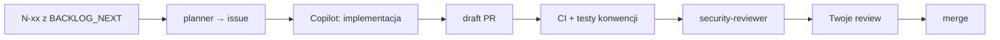

# MentorPath — jak pracować z agentami (workflow)

Status: **żywy dokument** (D-41). Dla człowieka; instrukcje dla agentów są w `AGENTS.md` i `.github/`.

## Tablica i „co dalej”

- **Tablica:** [MentorPath Backlog](https://github.com/users/szkoladotneta/projects/6) — każda pozycja N-xx / T-xx z `docs/BACKLOG_NEXT.md` to issue na tablicy. Kolumny `Status`: *Backlog → Planned → In progress → In review → Done*. Pola: Phase, Priority, Schema change, Estimate (h). To tu widzisz, co jest w toku; `BACKLOG_NEXT.md` zostaje planem produktowym (fazy, hipotezy, metryki).
- **Karty przesuwają się same:** planner ustawia *Planned*, agent implementujący *In progress* i *In review* (`scripts/board.sh`), a zamknięcie issue / merge PR ustawia *Done* (wbudowane workflow projektu). Jeśli agent nie ma uprawnień (np. cloud agent), wypisze, co przesunąć ręcznie.
- **Co dalej:** każdy agent i skill kończy odpowiedź sekcją **`## Next step`** — jedna konkretna rzecz do zrobienia i dosłowny prompt do użycia.

## Idea w jednym zdaniu

Ty wybierasz i zatwierdzasz, agenci planują i implementują, a **reguły pilnuje kod** (testy konwencji, CI, CODEOWNERS) — nie proza w promptach.

## Krok po kroku

1. **Wybierz kartę** z kolumny *Backlog* na tablicy (kolejność: faza, potem priorytet Must → Should → Could; fazy 4–5 mają warunki startu w `BACKLOG_NEXT.md`).
2. **Zaplanuj.** Uruchom agenta `mentorpath-planner` (Copilot CLI: `/agent` → `mentorpath-planner`; VS Code: wybór agenta w Chat; GitHub.com: panel agentów). Prompt: `Zaplanuj N10`. Agent uzupełnia istniejące issue karty (nie tworzy duplikatu) wg szablonu `backlog-item`: cel, kryteria akceptacji, macierz izolacji, pliki, poza zakresem, pytania otwarte.
3. **Przejrzyj issue (2 minuty).** Odpowiedz na „Open questions”, popraw kryteria. Jeśli wymaga zmiany schematu — planner to zaznaczy.
4. **Zleć implementację.** Wybierz jedno:
   - przypisz issue do **Copilot** (cloud agent) na GitHub.com — dostaje środowisko z `copilot-setup-steps.yml`;
   - albo lokalnie w Copilot CLI / VS Code: `Zaimplementuj issue #123` (skill `implement-backlog-item` załaduje się sam).
5. **Schemat najpierw.** Jeśli issue zmienia encje/migracje/`Contracts/`, agent otwiera osobny PR z etykietą `schema-change` i się zatrzymuje. Zmergujesz go ręcznie (CODEOWNERS), dopiero potem idzie PR funkcjonalny.
6. **Draft PR.** Agent buduje (0 ostrzeżeń), uruchamia testy modułu i otwiera draft PR z szablonu. CI: build, testy jednostkowe i integracyjne (w tym `ConventionTests`), `has-pending-model-changes`, skan podatnych pakietów.
7. **Niezależny przegląd bezpieczeństwa** (dla zmian dotykających dostępu do danych): agent `mentorpath-security-reviewer` na gałęzi PR → tabela znalezisk. Znaleziska wracają do agenta implementującego jako komentarze w PR.
8. **Twoje review i merge.** Sprawdzasz: kryteria akceptacji ↔ testy, macierz izolacji ↔ testy `NotFound`, nowe decyzje w `DECISIONS.md`. Merge, gdy CI zielone.

Dodajesz nowy pomysł spoza `BACKLOG_NEXT.md`? Utwórz issue z szablonu `backlog-item` i dodaj je do tablicy (przycisk *Add item* albo `gh project item-add 6 --owner szkoladotneta --url <issue>`). Dla pomysłów poza MVP i backlogiem najpierw wpis w `BACKLOG_NEXT.md`.

## Gdy czegoś brakuje w dokumentach

Agent nie zgaduje: dopisuje wpis `Proposed` do `docs/DECISIONS.md` i zgłasza w PR. Ty zmieniasz status na `Adopted` lub odrzucasz.

## Testy dopisywane osobno

Potrzebujesz tylko testów (np. dług pokrycia): agent `mentorpath-qa-tester` — edytuje wyłącznie `tests/**`.

## Co jest egzekwowane mechanicznie

| Reguła | Gdzie |
|---|---|
| `actorUserId` pierwszy parametr serwisu | `ConventionTests` |
| Każda metoda serwisu ma test `NotFound` dla obcego aktora | `ConventionTests` (+ `ForeignActorIsolationTests`) |
| Brak `AppDbContext` w Razor, `[Authorize]` na stronach, brak danych mentora w DTO mentee | `ArchitectureTests` |
| Brak global query filters, `TimeProvider`, `MarkupString` tylko w `<Markdown>` | `ConventionTests` |
| Moduł zapisuje tylko do swoich tabel | `ConventionTests` + `DOMAIN_RULES.md` §5 |
| Model EF zgodny z migracjami; podatne pakiety | CI |
| Zmiany schematu/Contracts/build/`.github` → review właściciela | CODEOWNERS + ruleset na `main` |

## Utrzymanie (kilka minut miesięcznie)

- Dependabot sam otwiera PR-y z aktualizacjami (NuGet, Actions, Docker) — merge po zielonym CI.
- Gdy dodajesz moduł lub tabelę: zaktualizuj `DOMAIN_RULES.md` §5 i słownik `WriteOwnership` w `ConventionTests` (test padnie, jeśli zapomnisz).
- Agent popełnia ten sam błąd dwa razy → dopisz jedną regułę do odpowiedniego `.github/instructions/*.instructions.md` albo, lepiej, test konwencji.
- Dług pokrycia izolacji (`IsolationCoverageDebt` w `ConventionTests`) może tylko maleć.

## Znane ograniczenia

- Automatyczne dodawanie nowych issue do tablicy (workflow *Auto-add to project*) włącza się tylko w UI: Project → ⋯ → Workflows. Włącz też *Item closed → Done* i *Pull request merged → Done*, jeśli nie są domyślnie aktywne.
- Cloud agent (Copilot na GitHub.com) nie ma dostępu do prywatnej tablicy użytkownika — `scripts/board.sh` wypisze wtedy, co przesunąć ręcznie. Lokalnie wymaga `gh auth refresh -s project`.
- CodeQL i secret scanning nie są dostępne dla prywatnego repo na planie Pro (GitHub Advanced Security). Zamiast nich: niezależny przegląd `mentorpath-security-reviewer` i skan podatnych pakietów w CI. Po zmianie planu lub upublicznieniu repo dodaj workflow CodeQL.

- `dotnet format --verify-no-changes` nie jest bramką CI: 12 istniejących plików ma niezgodności (końce linii, kolejność `using`, wygenerowana migracja). Do uporządkowania osobnym, mechanicznym PR-em.
- Playwright (`tests/e2e`) działa lokalnie przed wydaniem, nie w CI (D-33, backlog T01).
